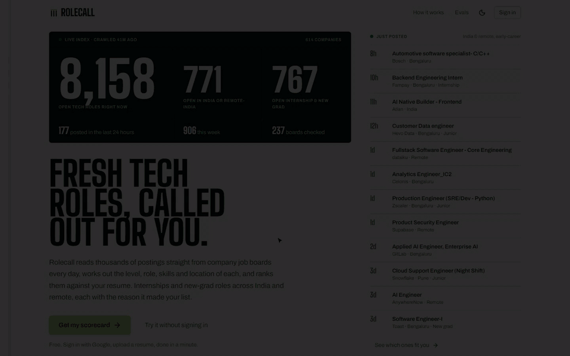
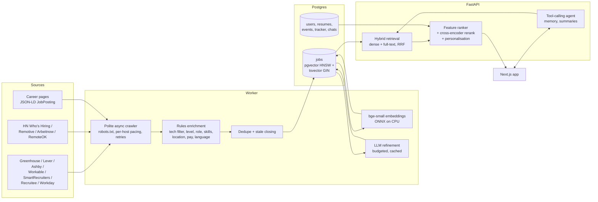

# Rolecall

[](https://github.com/aayushtiwari845/rolecall/actions/workflows/ci.yml)
[](LICENSE)


<p align="center">
  
  <br>
  <sub><a href="docs/media/demo.mp4">Full-quality MP4</a> · recorded on the live local index</sub>
</p>

**Fresh tech roles, called out for you.** Rolecall crawls thousands of job postings every
day straight from company job boards, works out the level, role, skills, location and pay
of each one, and ranks them against your resume, with the reason for every match. It is
built for Indian students and freshers hunting internships and new-grad roles across
software, ML/AI, data and infra, in Indian cities or remote.

- **Scorecard**: a personalised feed. Every role gets a match score plus the skills it
  matched, whether the level fits, where it is, and red flags ("asks for 3+ years").
- **Search**: plain-language search; keyword and semantic retrieval fused, then reranked.
- **Tracker**: saved → applied → OA → interview → offer, drag and drop, exports to Excel.
- **Assistant**: a tool-using LLM agent that searches the live index, compares roles,
  updates your tracker, sets alerts and remembers your preferences across chats.
- **Multiple resumes** (e.g. SWE and ML), **daily email digest**, **saved-search alerts**.
- **Public evals** page: ranking quality measured against the live index.

Runs entirely on free tiers: local ONNX embeddings, free LLM APIs (Groq, Gemini,
Cerebras, OpenRouter) or a local model, Postgres + pgvector, a free VM or free PaaS.

---

## Architecture



### How a role reaches your scorecard

1. **Discovery.** `rolecall discover` probes ~450 candidate companies against every
   supported ATS's public API and keeps the boards that answer with open jobs
   (224 companies, ~28k raw postings on the first run). Career pages without a known ATS
   are crawled for schema.org `JobPosting` JSON-LD, respecting `robots.txt`.
2. **Ingestion.** An async crawler fetches every board with bounded concurrency,
   per-host pacing and retries. ATS boards return their complete list, so a role missing
   from two consecutive runs is closed; aggregator listings expire by age.
3. **Understanding.** Deterministic rules (fully unit-tested) drop non-tech and
   non-English postings and extract seniority, role family, employment type, work mode,
   cities and countries, ~120 canonical skills, years of experience and pay (INR/LPA,
   USD, stipends). An optional LLM pass refines what the rules can't infer, within a daily
   free-tier budget, cached by content.
4. **Dedupe.** Same company + normalised title + place collapses to one canonical role,
   preferring the company's own board over aggregators.
5. **Indexing.** Each role is embedded locally with `BAAI/bge-small-en-v1.5` into a
   pgvector HNSW index; a weighted `tsvector` (title > company/skills > description)
   powers full-text search.
6. **Retrieval.** Dense (pgvector cosine) and lexical (Postgres FTS) candidates are fused
   with reciprocal rank fusion, under hard filters (level, role, location rules for
   remote-India / remote-worldwide, pay, freshness).
7. **Ranking.** Interpretable features, each in [0, 1] with a plain-language reason:
   semantic similarity, lexical score, skill coverage, level fit, role fit, location
   fit, recency, and affinity to the roles you saved vs hid. A penalty applies when a
   posting asks for more experience than you have. Results are diversified so one
   employer can't flood a page. Search additionally reranks its head with a
   cross-encoder (`ms-marco-MiniLM-L-6-v2`).
8. **Learning from you.** Saves, applies, clicks and dismissals move your query vector
   toward what you like and away from what you hide, and adjust per-company affinity.

### Freshness and coverage

- **How often.** The worker crawls every board not crawled in the last 5 hours, every 2
  hours, so each board is checked about four times a day (GitHub Actions does every 4
  hours in the card-free setup). New roles are embedded within 10 minutes.
- **What is crawled.** Every open role on ~240 company boards (Greenhouse, Lever, Ashby,
  Workable, SmartRecruiters, Recruitee), plus the monthly HN "Who is hiring" thread,
  Remotive, Arbeitnow and RemoteOK. ATS boards return their complete list, so a role
  that disappears from two runs in a row is closed.
- **How coverage grows.** A weekly discovery job probes companies that appear in the
  hiring threads and aggregators for their own boards, re-probes companies whose boards
  broke (they moved ATS), and picks up new names added to `seeds/candidates.txt`.
- **What is not.** LinkedIn, Naukri and Indeed forbid crawling and are never used.
  Workday tenants (most large enterprises) throttle automated clients, and Google,
  Microsoft and Amazon run their own portals, so they are not covered.
- **Staying healthy.** A board whose listing suddenly empties is flagged instead of
  having its roles closed; old data is pruned daily; `/api/health/index` returns 503 and
  admins get an email if crawling stalls. See
  [docs/deploy.md](docs/deploy.md#keeping-it-running-for-years).

### The assistant

An OpenAI-protocol tool-calling loop (every supported provider speaks it) with ten
tools: `search_jobs`, `recommend_jobs`, `get_job_details`, `compare_jobs`, `save_job`,
`list_applications`, `create_alert`, `update_preferences`, `remember`,
`jobs_at_company`. The system prompt carries your profile, preferences and long-term
memories; older turns are summarised to fit free-tier context windows. Replies stream to
the browser as server-sent events (tool steps, then the answer with job cards). Jobs the
model mentions are only rendered if a tool actually returned them, so it can't invent
roles. Per-user daily quotas protect the free tiers.

### LLM router

`app/llm/router.py` tries providers in a configured order, cools a provider down after
a rate limit (honouring `Retry-After`) and falls through to the next, validates structured
output against Pydantic schemas with one repair round, caches deterministic calls in
Postgres, and logs every call's tokens and latency for the admin dashboard. With no keys
at all, everything except the assistant and AI fit checks still works.

---

## Evals

`uv run rolecall eval all` runs five suites and stores results (shown on `/evals`).
The methodology (pooling, rubric, metrics, statistics, tuning and its full log) is in
[docs/evaluation.md](docs/evaluation.md).

| Suite | What it measures |
|---|---|
| **recsys** | The main one. 28 personas (10 dev for tuning, 6 test, 12 fresh personas written after tuning and judged blind), 909 (persona, role) pairs pooled from eight rankers plus the tuned configs and graded 0–3 against a written rubric. Graded nDCG@5/10/20, P@10, MAP, MRR, bpref, Success@5, violations of hard expectations (level, experience, location), diversity, exposure Gini, stability under profile edits, latency; 95% bootstrap CIs, paired randomisation tests, per-segment breakdowns. |
| **retrieval** | Known-item search: for a stratified sample of live roles, generate the query a student would type (LLM or templates), measure Recall@10/50, MRR@10, nDCG@10 and latency for lexical, dense, hybrid RRF and hybrid + reranker. |
| **recommendation** | Persona feeds (backend new grad, ML intern, data engineer, frontend, SRE). Each variant's top-k is pooled and judged once on a 0–3 scale (LLM judge or transparent rule judge); nDCG@10, P@10, company diversity, coverage. Ablations: dense only, lexical only, RRF only, no experience penalty, no diversity, full ranker. |
| **extraction** | Field accuracy (level, role, work mode, employment type, min years) on hand-labelled real postings: rules vs rules + LLM. |
| **agent** | Scripted conversations with expected tools; tool-selection accuracy, grounding (only real job ids) and pass rate. |

**Tuning** (`uv run rolecall tune`): retrieval depth by grid (candidate recall vs latency);
22 ranking parameters by Optuna TPE with a judged-aware objective, nested 5-fold
cross-validation to choose between a full and a trust-region search space, lower-bound
trial selection against the winner's curse, and iterative pooling of the tuned configs'
results; search fusion and reranking by grid under a measured 250 ms latency budget.
Each stage ships only if it holds on held-out personas or queries.

Result, honestly: ranking-weight tuning gave large gains on tuning personas (nDCG@10
0.58 → 0.75–0.79, p=0.002) that did not hold on the 6 test personas over four rounds.
Twelve fresh personas, judged blind under a pre-registered rule, then showed the tuned
weights at +0.07 nDCG@10 (7 wins, 4 losses, p=0.13), so they shipped as "not worse". Over
all 18 held-out personas the difference is +0.04 and not significant. Retrieval depth
(feed latency ~245 → ~150 ms, same quality) and search fusion without the CPU cross-encoder
(~3 s saved, no significant quality loss) shipped too. Tuning found two bugs (an O(n³) MMR,
now vectorised and 25–50× faster; a dev/test split that separated role families), and
judging the fresh pools found location and experience extraction gaps. Fixing those
("Remote US" roles leaking into Indian feeds; "7+ years in support" read as no
requirement) lifted fresh-persona nDCG@10 to 0.76 and P@10 to 0.30, and experience
accuracy on hand-labelled postings from 0.87 to 1.00 (see
[docs/evaluation.md](docs/evaluation.md#5c-after-the-extraction-fixes)). A later seniority
pass (architect and ladder titles, boards' own "Experience level" field, an overall
"10-14 years" beating a per-skill "1-2 yrs") retagged 128 roles and lifted every held-out
score again (fresh nDCG@10 0.77, test 0.65–0.71).

Latest numbers: see [`backend/evals/results/`](backend/evals/results) and [docs/evals.md](docs/evals.md).

---

## Run it locally

Requirements: Docker, Python 3.12 with [uv](https://docs.astral.sh/uv/), Node 20+ with pnpm.

```bash
cp .env.example .env                 # LLM keys optional
docker compose up -d db              # Postgres 16 + pgvector on :5433

cd backend
uv sync
uv run alembic upgrade head
uv run rolecall seed                 # load seeds/companies.yaml
uv run rolecall ingest               # first crawl: ~30 min for ~240 boards
uv run rolecall embed                # local embeddings
uv run uvicorn app.main:app --reload # API on :8000 (docs at /api/docs)

cd ../web
pnpm install
pnpm dev                             # app on :3000, proxies /api to :8000
```

Locally there's a development sign-in (no Google keys needed). Run the worker with
`uv run python -m app.worker` to keep the index fresh on a schedule.

Useful commands: `rolecall discover` (probe `candidates.txt`, rewrite the seed file),
`rolecall rediscover` (find new and moved boards, straight into the database),
`rolecall health`, `rolecall prune`, `rolecall stats`, `rolecall enrich-llm`,
`rolecall reenrich`, `rolecall eval <suite>`, `rolecall digest --email you@x.com`.

Tests: `uv run pytest` (unit tests plus end-to-end API tests against Postgres),
`pnpm lint && pnpm exec tsc --noEmit` in `web/`.

## Deploy for free

See [docs/deploy.md](docs/deploy.md): Next.js on Vercel's free tier; API, worker and
Postgres on an Oracle Cloud Always Free VM with Docker Compose and Caddy (automatic TLS).
A card-free alternative runs the API on a free PaaS with Neon Postgres and does ingestion
on scheduled GitHub Actions.

## Repository layout

```
backend/
  app/ingest/      crawler, ATS adapters, discovery, pipeline
  app/enrich/      rules, skills taxonomy, locations, embeddings, LLM refinement
  app/search/      filters, hybrid retrieval, ranker, personalisation, engine
  app/agent/       tools and the agent loop
  app/llm/         multi-provider router
  app/evals/       eval suites
  app/api/         FastAPI routers
  seeds/           candidate companies and discovered boards
  tests/
web/               Next.js app (App Router, Tailwind)
infra/             production compose, Caddy, Postgres init
docs/              architecture decisions, evals, deployment
```

## Design decisions

Short records of the important trade-offs live in [docs/decisions](docs/decisions):
why Postgres for everything, why rules before LLMs, hybrid retrieval with RRF, an
interpretable ranker before learning-to-rank, free-tier LLM routing, and the crawler's
politeness rules.
